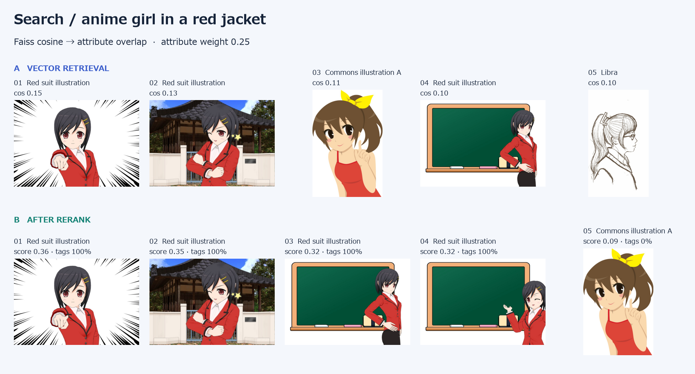
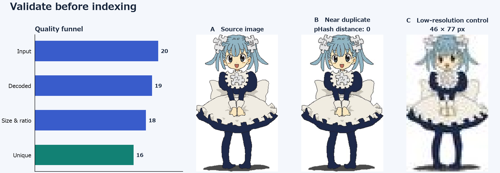
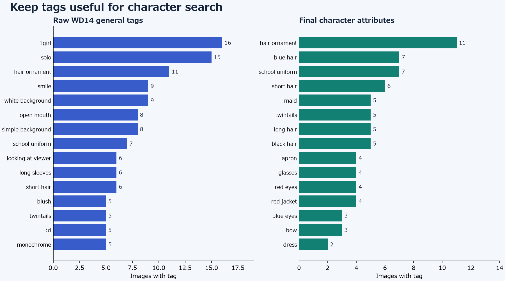
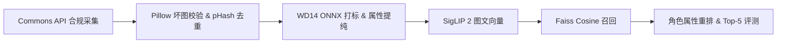

# 二次元角色多模态检索与清洗管线（anime-char-rag-pipeline）







## 项目亮点

在做二次元角色检索时，光靠通用多模态向量往往容易被背景或画风干扰——比如搜“穿红色夹克的角色”，单纯的向量相似度可能把红衣服但不同设定的角色排到前面。本项目搭建了一套**“合规采集 → 图像去重质检 → 角色属性提纯 → 向量召回 + 属性重排”**的完整数据管线：

- **入库前先质检**：用 Pillow 检查坏图、分辨率和长宽比，再用感知哈希（pHash）拦截视觉近重复样本，并把低清图与近似重复图纳入可视化对比。
- **把 Tag 洗干净再用于检索**：WD14 原始输出包含大量 `1girl`、`white background`、`smile` 等高频噪音词；脚本自动过滤背景与泛用动作词，只保留发色、瞳色、服饰和配饰等**角色强区分特征**。
- **双语检索 + 属性 Rerank**：支持日语、英语自然语言以及以图搜图；用 `0.75 × SigLIP 2 Cosine + 0.25 × 角色属性重合率` 对 Top-K 候选二次重排。

## 实测效果与工程思考

- **数据清洗效果**：从 Wikimedia Commons Action API 采集 17 张带明确许可的角色插画（含 3 张质检对照样本），经解码校验、尺寸比例过滤与 pHash 去重后保留 **16 张**干净图像入库，输出结构化 `data/clean/metadata.jsonl` 与剔除日志 `rejected.jsonl`。
- **重排收益**：三条日/英测试查询的首个相关结果均稳居 Top-1（**1 → 1**）；在 `"anime girl in a red jacket"` 查询中，加入角色属性重排后，4 张目标角色图进入前 5 名的比例（Recall@5）从 **75% 提升至 100%（3/4 → 4/4）**，有效压低了纯背景/服装近似干扰项。完整记录见 [assets/retrieval_metrics.json](assets/retrieval_metrics.json)。
- **工程复盘与扩展方向**：
  - 现阶段先看清洗日志再建索引，能快速定位“因为近似重复刷榜”或“低分辨率图拉偏向量”的问题；
  - 若扩展到万级以上角色库，可在当前独立查询集基础上补充“同服装异角色”“同角色换装”等困难负样本（Hard Negatives），进一步校准向量与属性重排的权重配比。

## 快速运行

需要 Python 3.11+ 与网络访问（首次运行会自动下载 WD14 ONNX 与 SigLIP 2 权重）。

```bash
python -m pip install -r requirements.txt
python 01_crawl.py
python 02_clean_and_dedup.py --demo-defects
python 03_tag_and_embed.py --device auto
python 04_search_and_rerank.py --demo
```

也可直接测试日文、英文描述或本地图片检索（图像 Tagger 使用 CPU ONNX Runtime，加 `--device cpu` 即可在无独立显卡环境跑通全流程）：

```bash
python 04_search_and_rerank.py --text "青髪のメイド、エプロン、髪飾り"
python 04_search_and_rerank.py --text "anime girl in a red jacket"
python 04_search_and_rerank.py --image data/clean/140742801.jpg
```

---

代码采用 MIT 协议；示例图署名与许可见 [图像署名说明](assets/ATTRIBUTION.md)。相关模型与规范：[Commons API Etiquette](https://www.mediawiki.org/wiki/API:Etiquette) · [WD14 Tagger](https://huggingface.co/SmilingWolf/wd-v1-4-vit-tagger-v2) · [SigLIP 2](https://huggingface.co/google/siglip2-base-patch16-224)
