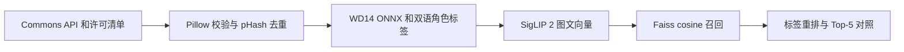

# 二次元角色多模态检索




## 快速运行

在仓库根目录运行。需要 Python 3.11 或以上、网络访问。首次运行会下载 WD14 和 SigLIP 2 权重。

```bash
python -m pip install -r requirements.txt
python 01_crawl.py
python 02_clean_and_dedup.py --demo-defects
python 03_tag_and_embed.py --device auto
python 04_search_and_rerank.py --demo
```

也可以单独试日文文本、英文文本或上传自己的路径做以图搜图。

```bash
python 04_search_and_rerank.py --text "青髪のメイド、エプロン、髪飾り"
python 04_search_and_rerank.py --text "anime girl in a red jacket"
python 04_search_and_rerank.py --image data/clean/140742801.jpg
```

图像 Tagger 固定使用 CPU ONNX Runtime。用 `--device cpu` 可在 CPU 上跑 embedding 和查询，无需 CUDA。`--limit 6` 可缩小首次采集，完整三条演示查询建议用默认 17 张。

## 数据如何流动

| 阶段 | 实现与输出 |
|---|---|
| 采集 | Wikimedia Commons Action API 按审核清单抓取源图和许可，分别请求日英说明。Commons 说明可能回退到源文件的既有语言。角色特征词及日英对照来自本仓库清单和受控词表。HTTP 重试、请求间隔和逐图保存支持中断再跑。 |
| 清洗 | Pillow 解码验证、短边与比例过滤、pHash 汉明距离去重。输出 `data/clean/metadata.jsonl` 和拒绝记录。质检控制样本包含低清、JPEG 缩放副本和损坏文件。 |
| 标签与索引 | WD14 预测普通标签。保留发色、瞳色、服饰和配饰词，合并审核标签。SigLIP 2 表征清洗图和角色说明，L2 归一化后构建图像与说明两个 Faiss FlatIP 索引。 |
| 搜索 | 日英文本和示例图都直接查询图像索引。Rerank 使用 `0.75 × cosine + 0.25 × 已满足查询标签比例`。没有有效标签时保留向量排序。以仓库内图像为查询时排除自身。 |

## 一次实际运行

17 张有明确许可的源图加 3 个质检控制样本，经过解码、尺寸和去重后保留 16 张。三条文本查询首个相关结果的排名均为 **1 → 1**。英文红色夹克查询 Recall@5 **75% → 100%**，因为有 4 张人工标记的相关图，重排前后分别找到 3 张与 4 张。以图查询也验证了去除自身后仍能召回同角色的其他图。记录见 [检索结果 JSON](assets/retrieval_metrics.json)。

审核 Tag 也参与了重排，这组样本用来展示管线和分数解释。独立评估要另建未共享审核标签的查询集，加入同服装异角色、同角色换装的反例。

## 面试怎么讲

1. 从一张近重复图和一张低清图开始，说明为什么先看清洗日志再做索引。
2. 选红色夹克查询，指出向量相似度和属性重合率怎样影响不同候选的顺序。
3. 如果错误标签把蓝发角色推到前面，用召回日志区分候选没进 Top-K 与候选被重排压低，再用独立查询集调权重。

代码采用 MIT。示例图及拼图内改编的作者、来源和许可在 [图像署名](assets/ATTRIBUTION.md) 中。第三方模型按各自条款使用。 [Commons API 使用规范](https://www.mediawiki.org/wiki/API:Etiquette) · [WD14 模型](https://huggingface.co/SmilingWolf/wd-v1-4-vit-tagger-v2) · [SigLIP 2 模型](https://huggingface.co/google/siglip2-base-patch16-224)
